# Sistema Integrado de Inspecao e Gestao-Predial

O objetivo futuro da plataforma é permitir que engenheiros realizem inspeções prediais, registrem ocorrências, caracterizem manifestações patológicas, realizem diagnósticos, elaborem laudos técnicos, planos de manutenção, planos de reforma e disponibilizem dashboards gerenciais aos clientes.

---

# Módulo RF01 — Cadastro e Gestão de Empreendimentos

## Como executar
```bash
cp .env.example .env            # ajuste DATABASE_URL, SESSION_SECRET (≥32 caracteres), SEED_*
npm install
npx prisma generate
npm run db:migrate              # prisma migrate deploy  (alternativa sem binários do Prisma: npm run db:apply)
npm run db:seed                 # cria organização + usuário ADMIN a partir de SEED_*
npm run db:seed:demo            # (opcional) dados de demonstração: "Condomínio Residencial Atenas"
npm run dev                     # http://localhost:3000   |   produção: npm run build && npm start
npm test                        # exige TEST_DATABASE_URL apontando para um banco VAZIO/descartável (é resetado!)
```
Anexos são gravados em `STORAGE_DIR` (fora de `public/`) e só são servidos por `/api/attachments/:id`, autenticado.

## Telas do sistema e como funcionam

As capturas abaixo foram tiradas do sistema rodando com os dados de demonstração (`npm run db:seed:demo`).

### Entrada (login)
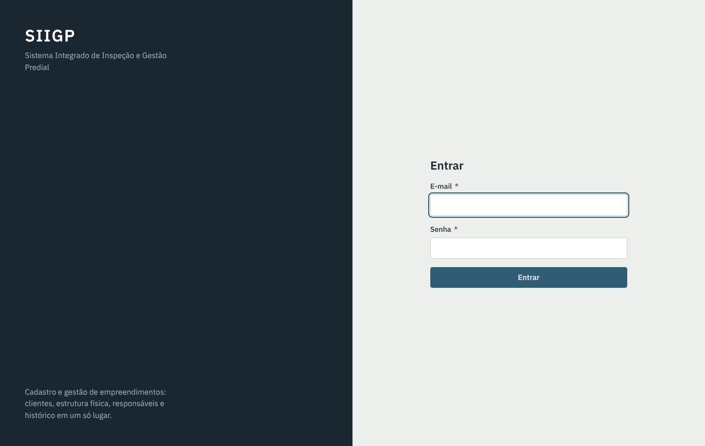

Acesso com e-mail e senha. A sessão fica num cookie protegido (HttpOnly) e expira em 8 horas. Após várias tentativas erradas o acesso é bloqueado por alguns minutos. Todo dado é isolado por organização: cada usuário só enxerga os registros da própria organização.

### Perfis de acesso
| Perfil | O que pode |
|---|---|
| Administrador | Tudo, inclusive desativar e reativar clientes e empreendimentos |
| Editor | Criar e editar cadastros, estrutura, responsáveis e histórico |
| Consulta | Somente ler. Dados pessoais (CPF, e-mail e telefone de pessoa física) aparecem parcialmente ocultos (LGPD) |

As permissões são conferidas no servidor, não apenas escondendo botões.

### Empreendimentos (lista)
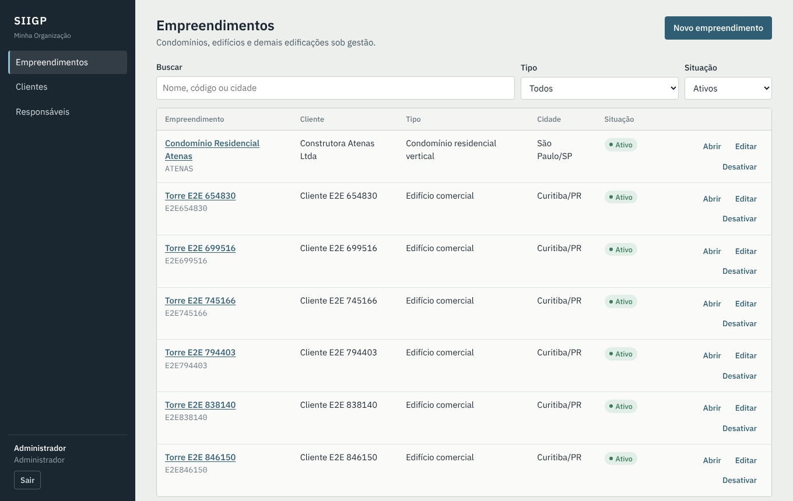

Lista paginada com busca por nome, código ou cidade e filtros por tipo e situação (ativos, inativos, todos). De cada linha é possível abrir, editar e desativar. Desativar sempre pede confirmação e nunca apaga dados: o empreendimento fica somente para consulta e pode ser reativado.

### Clientes
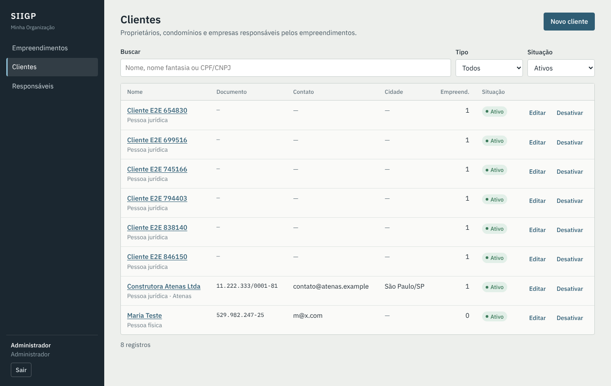

Cadastro de pessoas físicas e jurídicas. A busca aceita nome, nome fantasia ou CPF/CNPJ. CPF e CNPJ são validados (inclusive o CNPJ alfanumérico) e não podem se repetir dentro da organização. Um cliente com empreendimentos aparece com a contagem deles.

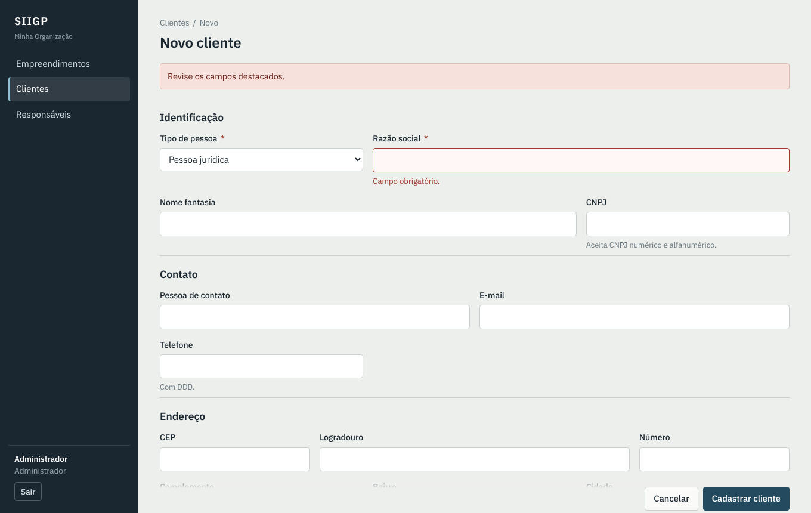

O formulário é dividido em seções (identificação, contato, endereço, observações), marca os campos obrigatórios com asterisco e mostra a mensagem de erro junto de cada campo. Dentro do cliente aparece a lista dos empreendimentos dele.

### Visão geral do empreendimento
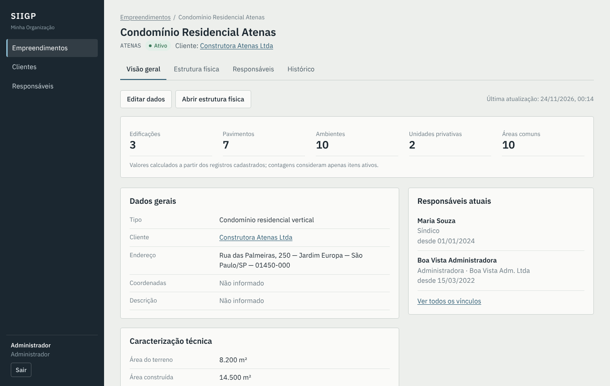

Todo empreendimento tem quatro abas: Visão geral, Estrutura física, Responsáveis e Histórico. A visão geral mostra os indicadores (edificações, pavimentos, ambientes, unidades privativas e áreas comuns) **calculados na hora a partir dos registros**, nunca digitados à mão. Mostra também dados gerais, caracterização técnica (a idade da edificação é calculada pelo ano de construção; se ele não existir, usa a idade estimada informada), os responsáveis vigentes e a data da última atualização.

### Formulário do empreendimento
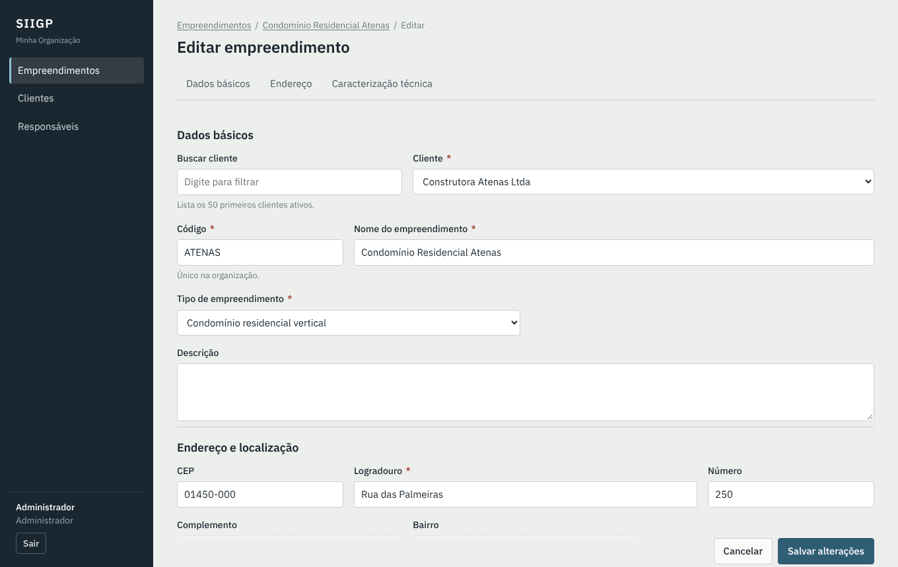

Três seções navegáveis pelas abas no topo: dados básicos (cliente, código único, nome, tipo), endereço e localização, e caracterização técnica (áreas, ano, uso, tipologia, sistema construtivo, ampliações e reformas). Seções com erro ficam marcadas com um ponto vermelho.

### Estrutura física
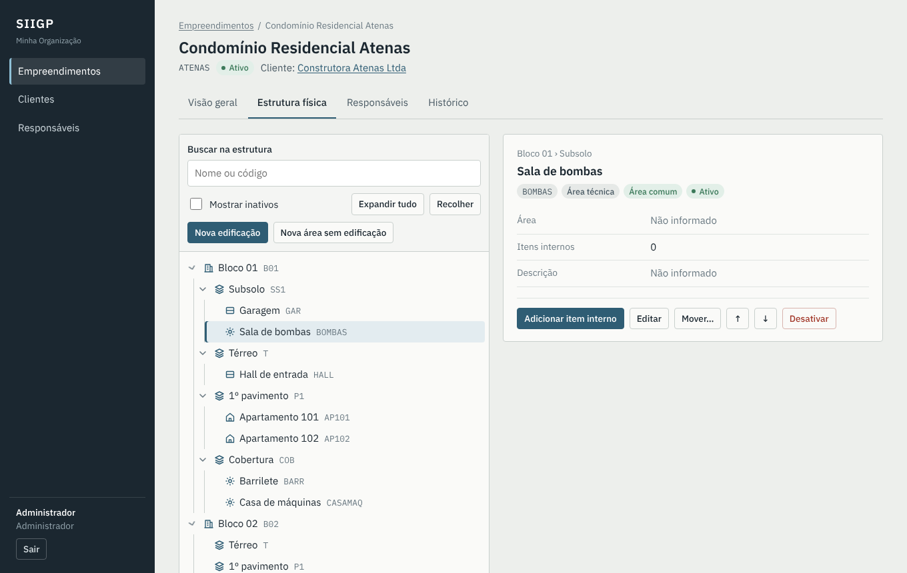

Árvore hierárquica: **edificação → pavimento → ambiente/área/unidade → itens internos**. Também aceita áreas sem edificação (piscina, jardins, estacionamento). Ao clicar num item, o painel da direita mostra o caminho, tipo, classificação (área comum, privativa ou não classificada), medidas e as ações:

- **Criar** no nível certo: nova edificação, novo pavimento, novo item dentro do selecionado. Unidades privativas guardam só tipo e área, sem dados de moradores.
- **Editar**, **reordenar** (setas) e **buscar** por nome ou código (a busca mostra o item com seus níveis acima).
- **Desativar** o item desativa também o que está dentro dele, após confirmação. Nada é apagado e dá para reativar.
- Códigos são únicos dentro de cada edificação.

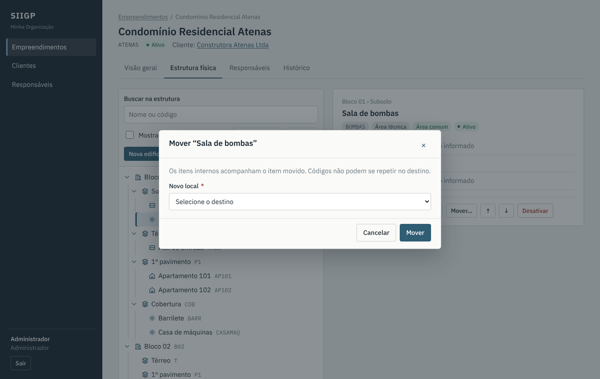

**Mover** leva o item e tudo o que está dentro dele para outro local. O sistema impede mover um item para dentro dele mesmo e códigos repetidos no destino.

### Responsáveis
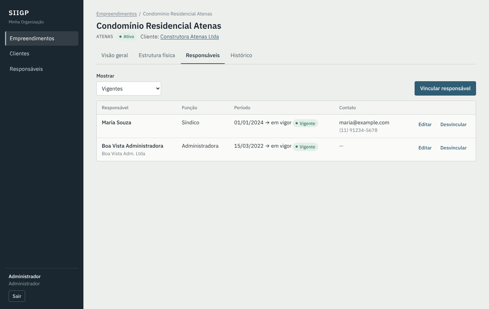

Síndico, administradora, zelador, responsável técnico etc., cada um com função e **período** (início e término). O mesmo responsável não pode ter dois períodos sobrepostos na mesma função. É possível vincular alguém já cadastrado ou cadastrar um novo na hora, editar o vínculo e **desvincular** (encerrar na data escolhida). O filtro alterna entre vigentes, encerrados e todos. Responsáveis são contatos do empreendimento, não usuários do sistema. A tela "Responsáveis" do menu lateral é o cadastro geral dessas pessoas.

### Histórico
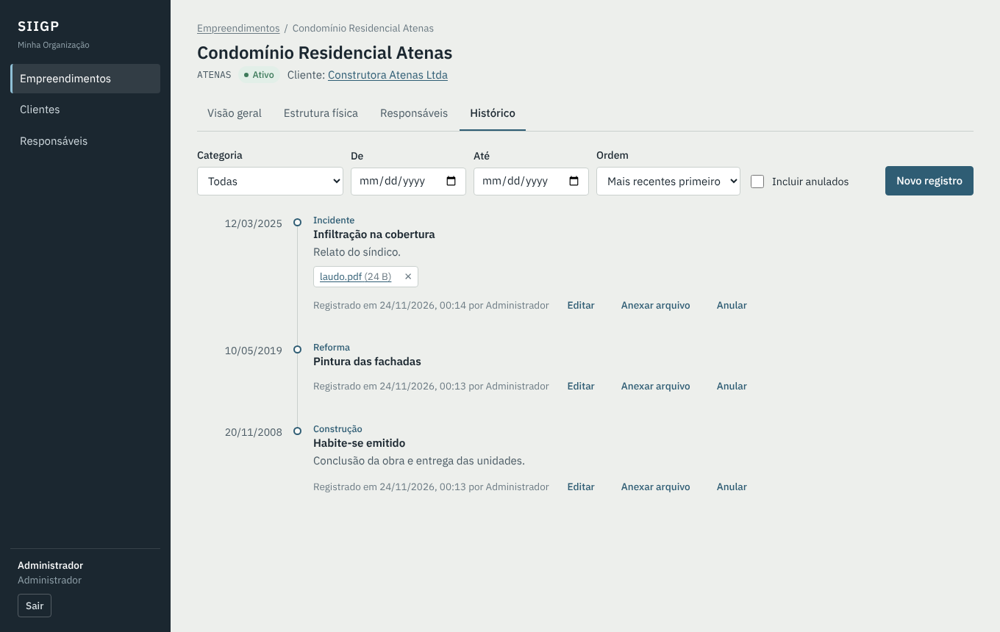

Linha do tempo do empreendimento (construção, ampliação, reforma, mudança de uso, incidentes, ocorrências relevantes e atualizações cadastrais), com filtros por categoria e período e ordem crescente ou decrescente. Cada registro pode ter anexos (PDF, imagens, planilhas, documentos), com limite de 15 MB, baixados só por usuários autenticados. Registros **nunca são apagados**: são **anulados com um motivo obrigatório**, ficam visíveis ao marcar "Incluir anulados" e podem ser restaurados. Toda alteração fica registrada na auditoria.

### No celular
| Estrutura física | Lista de clientes |
|---|---|
| 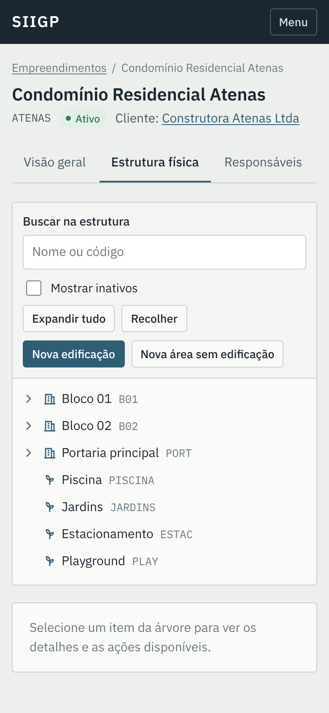 | 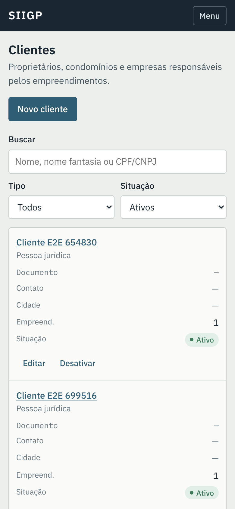 |

A interface se adapta a telas pequenas: o menu lateral vira um botão "Menu", as tabelas viram cartões e a árvore e o painel de detalhes ficam empilhados.

## Pendências e limitações reais
- Limite de tentativas de login é em memória (um processo); em produção com várias instâncias use Redis/gateway.
- Anexos em disco local; em produção usar armazenamento de objetos com acesso privado.
- Não há tela de gestão de usuários (fora do RF01); usuários são criados por seed/SQL.
- Sem exclusão física de cadastros (por desenho); a árvore não oferece "excluir", apenas desativar.
- Testes de interface são scripts Playwright ad hoc (não versionados como suíte); a cobertura automatizada versionada é de serviços/API/banco.
- Seletor de cliente no formulário de empreendimento lista os 50 primeiros ativos (com filtro por texto).
- Um vínculo de responsável encerrado "hoje" continua vigente até o fim do dia (a data de término vale inclusive).
- `npm run db:apply` foi criado porque o download dos binários do Prisma estava bloqueado no ambiente de desenvolvimento; em máquina normal use `npm run db:migrate` (não testado fora desse ambiente).
- Interface testada apenas no Chromium (desktop e 390 px); sem auditoria com leitor de tela.
- Fora do escopo deste módulo (não implementado): RF02–RF14 (sistemas técnicos, inspeções, ocorrências, laudos, planos, dashboards, gestão de usuários).

